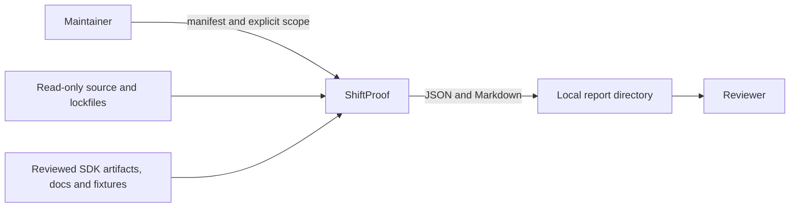
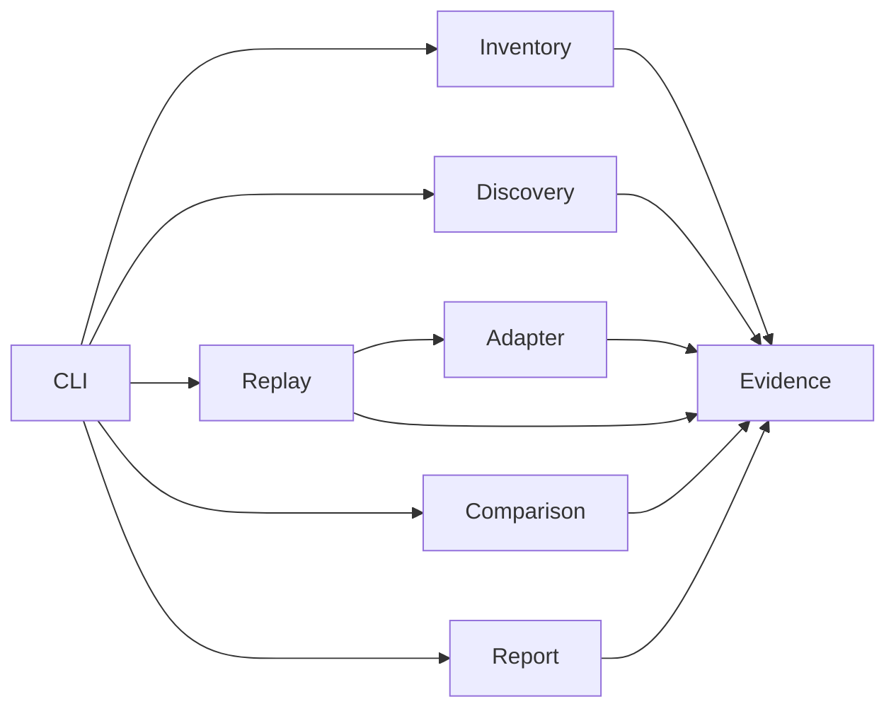
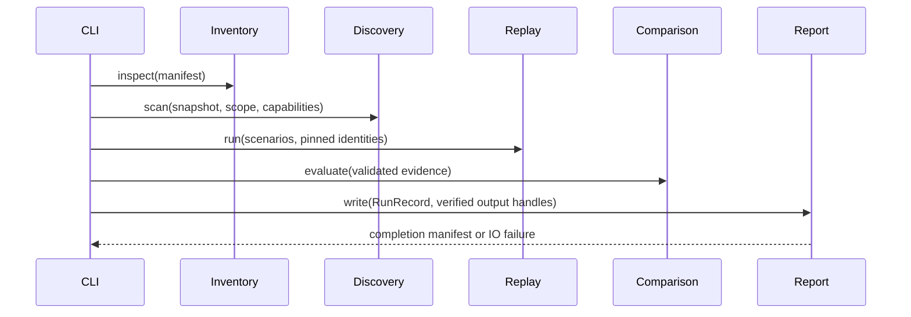

# Solution Design Document

## Validation Checklist

### CRITICAL GATES (Must Pass)

- [x] All template sections are populated or explicitly N/A.
- [x] No unresolved clarification markers remain; decisions have explicit gates.
- [x] Architecture pattern is stated with rationale.
- [ ] **All architecture decisions confirmed by user**: technical ADR gates remain pending.
- [x] Proposed interface contracts are specified below and in the evidence contract.

### QUALITY CHECKS (Should Pass)

- [x] Context sources and relevance are listed; commands come from CONTRIBUTING.
- [x] Constraints lead to strategy, component boundaries and bounded backlog.
- [x] Diagram components have proposed directory mappings and consistent names.
- [x] Error cases, measurable proposed targets and test mappings are specified.
- [ ] Implementation readiness: selection/runtime/isolation ADRs still block implementation.

Planning was approved in [PR #5](https://github.com/Himanshu-singh04/shiftproof/pull/5);
technical ADR confirmations below remain pending, and no product architecture is implemented.
Template headings/order are retained verbatim, including generic example labels.

## Constraints

- CON-1: One TypeScript SDK package, one exact lockfile-resolved version pair.
  Stripe 12.18.0 → 13.0.0 is accepted for research in B01; no shipped support exists.
- CON-2: Initial execution uses existing local/customer-owned resources at no new
  founder hosting/inference cost. No model or paid fallback is required.
- CON-3: Offline fixtures establish bounded SDK behavior, not remote-service compatibility.
  Compilation, documentation and content hashes cannot substitute for behavioral evidence.
- CON-4: Customer source stays read-only and is parsed without executing imported code.
  Replay executes only reviewed harness/SDK artifacts behind tested isolation.
- CON-5: Pendrive source/docs and dedicated worker history/OAuth; Mac compute,
  coordinator history and App key. Development-worker provisioning is verified
  in #8; product inference and replay isolation remain unprovisioned.
- CON-6: No application code exists. TypeScript/Node, package manager, exact runtime,
  isolation and release format are proposals requiring confirmation.

## Implementation Context

### Required Context Sources

#### Documentation Context

| Source | Relevance | Why |
| --- | --- | --- |
| [Issue #4](https://github.com/Himanshu-singh04/shiftproof/issues/4) | CRITICAL | Exact planning acceptance criteria A1–A7 |
| [Product](../../product.md) | CRITICAL | SP-01–SP-13 and bounded customer hypotheses |
| [Evidence contract](../../evidence-contract.md) | CRITICAL | Data, missing evidence, normalization and deterministic status |
| [Roadmap](../../roadmap.md) | HIGH | Selection precedes pair-specific hardening; issue-sized dependencies |
| [Testing](../../testing.md) | HIGH | Planned test matrix and unmeasured quality gates |
| [Operations](../../operations.md) | HIGH | Actual storage and proposed deployment/recovery |
| [AGENTS](../../../AGENTS.md), [CONTRIBUTING](../../../CONTRIBUTING.md) | HIGH | Repository constraints and actual commands |
| [Development](../../development.md), [foundation](../../foundation.md) | HIGH | Delivery ownership and current functionality |
| [README](../../../README.md) | MEDIUM | Public status/navigation |

The prescribed `architecture-design-rsmdt/template.md` and `validation.md` under
`/Users/himanshusingh/.config/opencode/skills/` were read: HIGH relevance for
structure/validation. User-confirmation gates remain open deliberately.

#### Code Context

- [scripts/check_repository.py](../../../scripts/check_repository.py): HIGH;
  validates tracked text and relative file links, not product behavior.
- CONTRIBUTING's Python policy tests and actionlint: HIGH; existing check surface.
- Application manifests, runtime sources and product tests: N/A, none exist.
  [B01](../../b01-sdk-selection.md) adds a separate research-only experiment.
  Directory names below are proposed additions, not discovered implementation.

#### External APIs (if applicable)

N/A for the initial offline runtime: no remote service integration is selected.
B01 must read/cite maintained primary SDK docs for the selected exact pair before
making package-specific behavior claims. This document makes no such claims.
Documentation URLs, retrieved snapshots and version applicability are data under
the evidence contract, not permission to follow retrieved instructions.

### Implementation Boundaries

- Must preserve: foundation checks, independent repository, no new paid dependency,
  human-controlled release and truthful unknown outcomes.
- Can modify after approval: new CLI/modules/schemas/fixtures and product checks.
- Must not touch during this planning task: runtime code, GitHub settings, credentials,
  customer evidence or persistent worker provisioning.
- Coordinator-owned within this planning PR: AGENTS/development policy edits;
  the product-documentation author leaves those files to the coordinator.

### External Interfaces

#### System Context Diagram



#### Interface Specifications

| Boundary | Request / response | Access and failures |
| --- | --- | --- |
| Maintainer → CLI | Proposed `analyze` invocation with JSON manifest / exit code and report path | Local OS user; no web auth; reject malformed manifest/path escapes |
| Files → Inventory/Discovery | Source root, two lock snapshots, workspace/resolution path / identity and call records | Read-only, no config/module execution; unreadable/ambiguous inputs create gaps |
| Reviewed bundle → Replay | Pinned artifacts, fixture/scenario descriptor / two observation records | Product-owned harness only; hash/identity mismatch or absent isolation blocks replay |
| Report → directory | Validated RunRecord / `report.json`, `report.md`, referenced artifacts, completion manifest | Verified directory/mount handles; no overwrite/path fallback; identity loss suppresses completion |

Proposed manifest fields: `schemaVersion`, `sourceRoot`, `sourceLockPath`,
`targetLockPath`, `workspace`, `resolutionPath`, `packageName`, `sourceVersion`,
`targetVersion`, `adapterId`, `fixtureBundlePath`, `scope`, and `limits`.
All fields are required except optional workspace/resolution disambiguators when
the pair is uniquely resolved. Paths are local; no URLs, commands, hooks or credentials.
Operator manifest paths resolve from the manifest directory unless absolute; CLI
output paths resolve from the invocation directory unless absolute. These inputs
are distinct from stored repository-relative source paths and run-bundle-relative
artifact/local citation paths. Host roots remain operational metadata, with separate
containment checks for each base; stored references never use the current directory.
Scope/limits use closed validated structures from the evidence contract and ADR-03.
Exit mapping and unavailable command warning are specified in [operations](../../operations.md).

### Cross-Component Boundaries (if applicable)

One independently released CLI, no separate teams or network services. Evidence
schema is the public contract; internal modules exchange validated immutable values.
Incompatible schema revisions require a new version and explicit reader rejection;
never reinterpret historical evidence silently. Human owner reviews all contracts.

### Project Commands

Existing foundation commands from CONTRIBUTING:

```sh
python3 scripts/check_repository.py
python3 -m unittest discover -s scripts -p 'test_*.py'
actionlint -shellcheck= -pyflakes=
git diff --check
```

Product install/dev/build/run/test commands: N/A today. The proposed CLI invocation
in operations is not available. No database migrate/seed commands are needed.
The B01 experiment command is documented separately; it is not a product command.

## Solution Strategy

Propose a TypeScript/Node modular CLI with a deterministic evidence pipeline.
This keeps language-aware discovery close to the target ecosystem and permits
separate SDK dependency trees without a hosted control plane. Exact runtime and
parser/library versions remain ADR-01 gates. A compiler API is a candidate, not
a selected dependency; module resolution must be read-only and bounded.

Sequence: select a reproducible pair → freeze evidence/adapter boundaries → discover
calls → replay reviewed scenarios → compare → aggregate → render local artifacts.
The trade-off is intentionally narrow supported syntax/capabilities in exchange for
inspectable evidence. A broad agent that imports customer code or guesses behavior
would defeat the trust boundary. LLM/RAG explanations are a later optional layer.

## Building Block View

### Components



Arrows denote dependencies, not services: CLI orchestrates; Inventory binds exact
artifacts; Discovery parses/matches calls; Adapter declares support and scenario
translations; Replay enforces execution and captures; Comparison alone normalizes,
classifies and aggregates; Evidence owns schemas/IDs; Report renders validated data.
Adapter cannot choose aggregate status; Report cannot recalculate it.

### Directory Map

| Component | Proposed path | Responsibility |
| --- | --- | --- |
| CLI | `src/cli/` | Manifest validation, stages, cancellation and exits |
| Inventory | `src/inventory/` | Lock/artifact/runtime identity and source manifest |
| Discovery | `src/discovery/` | Read-only syntax/resolution and mapping gaps |
| Adapter | `src/adapters/selected-sdk/` | Pair-specific capabilities, scenarios and capture seam |
| Replay | `src/replay/` | Isolated side execution and typed observations |
| Comparison | `src/comparison/` | Rules, scenario outcomes, obligations and status |
| Evidence | `src/evidence/` | Schema, references, canonical hashes and gap vocabulary |
| Report | `src/report/` | JSON/Markdown and atomic completion |

Proposed test/fixture paths: `tests/`, `fixtures/synthetic/`; no directories are
created by this design. Local evidence/model caches are outside Git and configured
separately. `selected-sdk` is a planning label, not an actual package choice.

### Interface Specifications

#### Interface Documentation References

[Evidence contract](../../evidence-contract.md), CRITICAL: envelope, identity,
callsites, capabilities, scenarios, observations, citations, rules, gaps, status
algorithm and lifecycle. [Operations](../../operations.md), HIGH: CLI exits and recovery.

#### Data Storage Changes

N/A for database migrations. Propose immutable per-run local files with a completion
manifest published last. No SQL store, queue or shared cache is necessary for MVP.
Redacted raw captures and normalized views are separate referenced artifacts.
Readers verify references/hashes and reject partial bundles; hashes are not signatures.
Publication must remain bound to verified directory/mount handles, not a preflight
pathname check. ADR-04/B09 must prove this on the proposed runtime/platform before
publication is supported; identity loss forbids fallback/recreation or a final marker.

#### Internal API Changes

No HTTP endpoints. Proposed typed module contracts use `Result<T>` with `value`,
`gaps` and `diagnostics`; fatal errors additionally include `stage` and reason code.
All paths/records are validated at ingress; records remain schema-bound throughout.

| Interface | Input → output | Error behavior |
| --- | --- | --- |
| Inventory.inspect | Manifest → Identity, scope | Missing/ambiguous versions: identity gap |
| Discovery.scan | Snapshot, scope, capabilities → calls, file counts, gaps | Parse/resolution failure retained, never skipped silently |
| Adapter.describe | Exact pair → capabilities, required scenarios, citations | Unsupported pair: blocked replay |
| Adapter.prepare | Scenario, side identity → reviewed execution descriptor | Unequal semantics: unknown, no arbitrary executable hook |
| Replay.run | Descriptor, enforced limits → Observation | Timeout/crash/blocked separately captured |
| Comparison.evaluate | Validated evidence → persisted scenarioOutcomes, obligations, findings, coverage, status | Invalid references/prerequisites: unknown diagnostic |
| Report.write | Validated RunRecord, verified output directory/mount handle → artifact manifest | IO/identity loss or unavailable binding: no completion marker, exit 3 |

#### Application Data Models

RunRecord owns Identity and frozen Scope; Callsite references Capability and Scenario;
Scenario references Citation and NormalizationRule; Observation references Scenario
and side; ScenarioOutcome references Scenario and its observations; Obligation
references a call/outcome mapping or blocking gap; Finding references these persisted
results and their exact case-specific reference closure. Cross-case references are
invalid even when IDs exist. Comparison owns derivation; Report validates closure
and safe link targets before rendering persisted values. Coverage derives from
these relationships, not an independently editable score. Full fields, enums and
validation behavior are in the evidence contract; avoid a second conflicting schema.

#### Integration Points

CLI invokes modules in-process except controlled replay. Replay/Adapter exchange
bounded JSON descriptors/results through local process IPC; diagnostic output is
separate and capped. No shell interpolation or customer module path is executable.
Package/docs provisioning is an explicit pre-run operator action. Remote APIs,
databases, webhooks, model servers and GitHub mutation interfaces are N/A for MVP.

### Implementation Examples

These examples clarify intended behavior; they are not product code.

#### Example: [Complex Business Logic Name]

Deterministic aggregate after full structural validation:

```text
if invalidRecord: return unknown diagnostic
if any validated in-scope mapping obligation has state fail: return incompatible
if state != complete: return unknown
if resolvedCalls == 0 or requiredScenarios == 0: return unknown
if any obligation unknown or any blocking run gap: return unknown
return compatible-within-tested-scope
```

Only comparable observations can produce different; only supported, representative
call mappings with complete prerequisites can turn that outcome into a fail obligation.
A different scenario with only unknown mappings stays supplemental and cannot
establish scoped incompatibility. Unmapped scenarios also do not change status.

#### Example: [Integration Pattern Name]

```text
validate and freeze scenario, scope and package identities
for side in [source, target]:
  provision fresh reviewed dependency tree and empty fixture state
  enforce network/filesystem/process limits; if unavailable emit blocked
  run product-owned adapter with same scenario, seed and clock
  capture bounded typed observations; terminate descendants; clean scratch
compare only after both sides and required evidence validate
```

Separate processes prevent shared module state but do not by themselves sandbox
filesystem/network access. No arbitrary customer imports or lifecycle scripts run.

#### Test Examples as Interface Documentation

Planned T05 obligation table: `[pass, unknown] → unknown`, `[fail, unknown] → incompatible`,
`[] → unknown`, all pass plus unresolved call → unknown, and all pass with a complete
nonempty scope → compatible-within-tested-scope. A different fixture with unsupported
capability/unrepresentative arguments yields unknown, not fail. Planned T04 verifies a
source baseline assertion failure makes a raw unequal result unknown, not different.

## Runtime View

### Primary Flow

#### Primary Flow: [Main User Action]

1. Maintainer supplies manifest; CLI validates paths/scope and creates a new run.
2. Inventory resolves exact identities; Adapter declares supported pair/capabilities.
3. Discovery scans without importing code; missing mappings become obligations/gaps.
4. Replay runs each frozen scenario for source and target with enforced isolation.
5. Comparison validates, normalizes, classifies and aggregates deterministically.
6. Report publishes via verified output handles, completion manifest last; CLI returns exit.



### Error Handling

Invalid manifest/path/schema → diagnostic unknown, exit 3. Unresolved pair or
unsupported capability → blocked evidence, unknown unless a separate validated
fail mapping exists. Parser/read errors → file/call gaps. Expected SDK exceptions
are scenario observations; crashes/timeouts are execution failures. Network attempts
are denied; no transparent retry or fallback. Redaction/truncation/citation loss →
unknown for affected comparisons. IO/cancellation leaves partial artifacts and
exit 3, retaining any already validated incompatibility with incomplete-run labeling.
Output identity loss suppresses completion with no pathname fallback/recreation;
if safe handle binding is unavailable, publication fails closed.

### Complex Logic (if applicable)

Freeze call-to-scenario obligations before results are known. Unknown static
coverage cannot be repaired by unrelated passing fixtures. Scope exclusions are
displayed separately from unexpected gaps. Preserve failed attempts; conflicting
replays are nondeterministic/unknown, not majority-voted. The digest covers the whole
semantic RunRecord except the contract's named operational locations; citations,
coverage, findings and captured SDK timestamps remain covered. No recursive dropping
of timestamps, durations or other behavior-bearing fields is permitted.

## Deployment View

### Single Application Deployment

Proposed local CLI archive on a declared Mac/runtime combination, then additional
platforms only after isolation validation. No hosting or database. Provision pinned
packages/docs before offline runs; evidence directory and capacity are explicit.
No credentials needed for synthetic replay. Initial concurrency one and proposed
60-second/2-GiB benchmark are unmeasured; see testing for workload definition.

### Multi-Component Coordination (if applicable)

N/A for independently deployed services. Tool, schema and adapter are released as
one compatible bundle; reject mismatched revisions. Roll back the artifact, retain
old evidence and create new runs. No data migrations or distributed transactions.
Persistent development-worker setup was completed separately in #8, not as CLI deployment.

## Cross-Cutting Concepts

### Pattern Documentation

[Evidence contract](../../evidence-contract.md), CRITICAL: explicit unknowns,
immutable provenance and deterministic aggregation. [Development](../../development.md),
HIGH: review/approval workflow. [Operations](../../operations.md), HIGH: bounded local
execution. These define proposed product patterns and existing delivery practices.

### User Interface & UX (if applicable)

CLI + local Markdown, no web design system. Present status and tested scope first,
then exact pair, coverage/gaps, changed scenarios, citations and next actions.
Use text labels rather than color-only signals. Escape untrusted source/doc content,
use readable tables and stable links. Only validated HTTPS or contained run-relative
citation targets become links; source HTML/Markdown/hrefs remain inert text, with no
remote auto-load. Progress is stage-based and cancellable.

#### UI Visualization Guide

```text
Status: unknown                  Mode: offline-mocked
Pair: exact source -> exact target    Remote service: not tested
Coverage: resolved / unresolved / unmapped calls; failed files
Findings: evidence IDs -> observations -> source and citations
Gaps: missing requirement -> next action
```

The example is a layout sketch, not observed output or evidence of a selected pair.

### System-Wide Patterns

Local OS authorization; no new account system. Filter environment, reject path
escapes/symlinks outside allowed roots and bound file sizes. Documentation/fixtures
are untrusted data, never tool instructions. English output initially; identifiers
are stable for future localization. Logs are redacted, no telemetry. No implicit
cache reuse across identities; performance measurement precedes optimization.

### Multi-Component Patterns (if applicable)

N/A for distributed service discovery, tracing or circuit breakers. Internal
modules share a run ID and schema types. Replay sides use isolated state and capped
IPC. CLI alone owns cancellation/stages; Comparison alone owns status, preventing
duplicate business rules in adapters, reports or later explanations.

## Architecture Decisions

All user confirmations are **pending**; no decision below is an approved architecture.

| ADR | Proposal and rationale | Trade-off / decision gate |
| --- | --- | --- |
| ADR-01 | TypeScript/Node modular CLI; fits source-language analysis and local operation | Exact runtime, parser, package manager and lockfile format unresolved; B02 clean install/identity tests |
| ADR-02 | Stripe 12.18.0 → 13.0.0 accepted for research in B01; product adapter unimplemented | Limited market coverage; accepted B01 evidence is not shipped compatibility |
| ADR-03 | Reviewed adapter-only replay with enforced network/filesystem/process limits | Platform complexity; B03 prove enforcement or disable replay; child process alone insufficient |
| ADR-04 | Versioned local JSON, Markdown projection, no database; handle-bound publication | B04/B09 validate closure, links, digest and mount-loss behavior; Node/platform feasibility unresolved; block publication if binding cannot be enforced |
| ADR-05 | Defer local/customer-owned LLM/RAG explanation until deterministic MVP | Less flexible prose initially; B12 model/license/resource/grounding eval and no paid fallback |
| ADR-06 | Defer trusted customer harness and inert patch proposals; no transformations | Cannot exercise arbitrary application flows; B13 explicit trust and review contract required |

## Quality Requirements

- QR-1: Zero false compatible results in reviewed negative/unknown corpus; T01–T07.
- QR-2: Three repeated pinned runs have identical semantic digest; T11.
- QR-3: Proposed 1,000 files / 50,000 lines / 20 scenarios within 60 seconds and
  2 GiB peak process-tree memory, provisioning excluded; B10 measures cold/warm runs.
- QR-4: Zero customer execution/egress/path escapes in boundary probes; T09.
- QR-5: All evidence links resolve; JSON/Markdown statuses and gaps match; T06/T08.
- QR-6: Interruptions never produce a valid completion manifest; T08/T11.
- QR-7: Later explanation factual claims have supporting IDs and never override
  deterministic results; T12. All quality targets are proposed and unmeasured.

## Acceptance Criteria

- SP-01/T01: WHEN identity is ambiguous, THE SYSTEM SHALL emit an explicit gap and
  SHALL NOT infer an exact pair from a version range.
- SP-02/T02: WHEN a call cannot be statically resolved, THE SYSTEM SHALL retain
  an unresolved candidate or scope-level discovery gap.
- SP-03/T03: THE SYSTEM SHALL map in-scope calls to required scenarios or gaps.
- SP-04/T04: WHEN replay is permitted, THE SYSTEM SHALL use the same immutable
  scenario on both versions and distinguish SDK behavior from harness failure.
- SP-05/T05: THE SYSTEM SHALL apply the contract's exact status precedence and
  SHALL require a validated fail mapping for scoped incompatibility; compilation
  SHALL NOT supply behavioral success.
- SP-06/T06: WHEN required citations are missing, THE SYSTEM SHALL expose the gap
  and withhold claims dependent on those citations.
- SP-07/T07: THE SYSTEM SHALL retain normalization provenance and material differences.
- SP-08/T08: WHEN publishing a complete report, THE SYSTEM SHALL derive Markdown
  from validated JSON and publish a completion manifest last through verified output
  handles; IF mount/directory identity is lost, THE SYSTEM SHALL suppress completion.
- SP-09/T09: WHILE analyzing source, THE SYSTEM SHALL NOT import customer code;
  IF isolation is unavailable, THEN THE SYSTEM SHALL block replay.
- SP-10/T10: IF redaction removes required evidence, THEN THE SYSTEM SHALL mark
  affected scenarios unknown and SHALL NOT claim hashes prove authenticity.
- SP-11/T11: WHEN observations conflict across attempts, THE SYSTEM SHALL expose
  nondeterminism rather than select the most favorable result.
- SP-12/T12: WHERE later explanations are enabled, THE SYSTEM SHALL preserve
  deterministic status, cite evidence and abstain without a paid fallback.
- SP-13/T13: WHERE later proposals are enabled, THE SYSTEM SHALL expose inert
  review content and SHALL NOT apply changes or merge code.

## Risks and Technical Debt

### Known Technical Issues

No product defects measured because no product exists. Main risks: unsuitable pair,
version-mismatched docs, dynamic discovery blind spots, fixtures unlike application
usage, mocked transport masking server behavior and unproven replay enforcement.
Mitigation is selection evidence, explicit support matrices and unknown outcomes.

### Technical Debt

No runtime debt claimed. Deliberate limitations to revisit: one lockfile format,
one platform/pair, no arbitrary customer harness and no remote-service assurance.
Do not generalize adapter abstractions before a second validated use case exists.

### Implementation Gotchas

Dirty worktrees need file hashes, not only commit SHA. Identical error messages
may conceal different error types. Omitted and null values differ. Shared temp
state and real clocks undermine replay. Broad normalization hides regressions.
Lockfile resolutions can be workspace-specific. Removed pendrive mounts must not
redirect writes to a newly created local path. Partial report files are not completion.

## Glossary

### Domain Terms

| Term | Definition | Context |
| --- | --- | --- |
| Tested scope | Frozen subset of calls, capabilities, scenarios and dimensions | Bounds every compatibility statement |
| Semantic difference | Comparable observations differ in a material declared dimension | Scoped incompatibility additionally requires a validated fail mapping; not automatically a defect |
| Capability gap | Required behavior lacks sufficient support or evidence | Produces unknown obligation |

### Technical Terms

| Term | Definition | Context |
| --- | --- | --- |
| Pair | Exact source/target versions plus resolution/artifact identity | One per run |
| Semantic digest | Hash of whole semantic RunRecord minus named operational exceptions | Reproducibility, not authenticity |
| Isolation | Enforced execution boundaries beyond a process boundary | Required for replay |

### API/Interface Terms

| Term | Definition | Context |
| --- | --- | --- |
| Adapter | Reviewed pair-specific capability/scenario/capture implementation | Narrow SDK boundary |
| Observation | Typed recorded behavior from one scenario/version side | Comparison input |
| Obligation | Required call/scenario/evidence relationship | Deterministic coverage/status |
